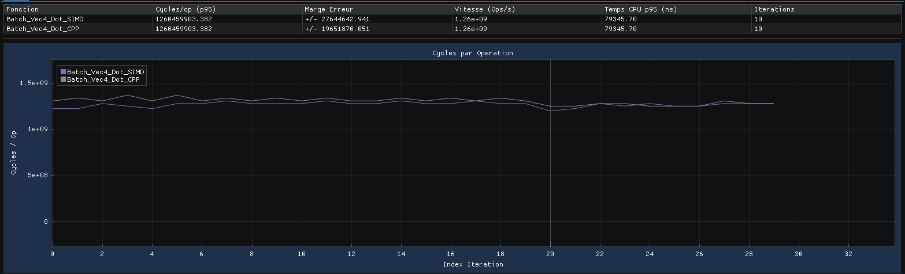
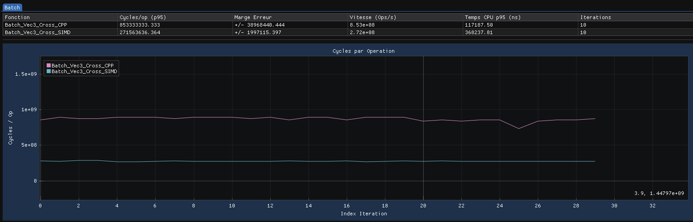
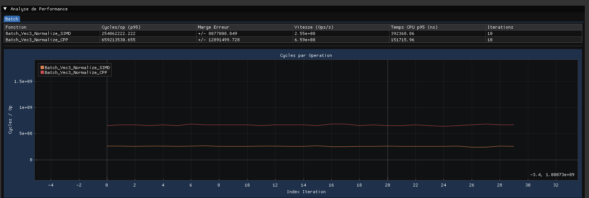
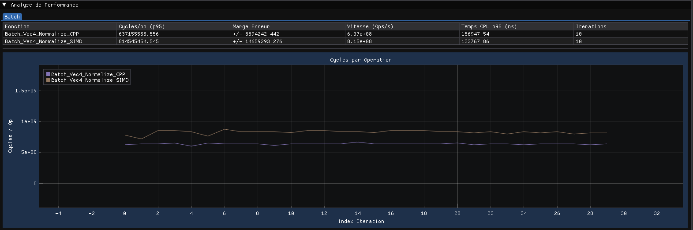
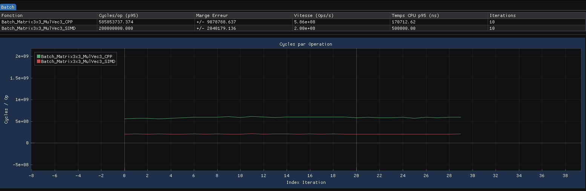
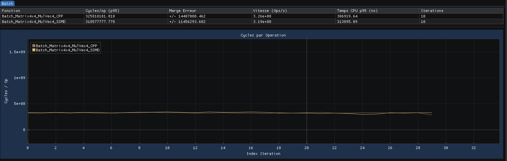
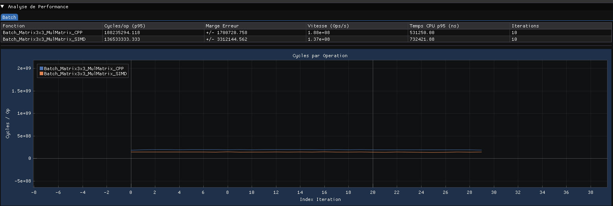
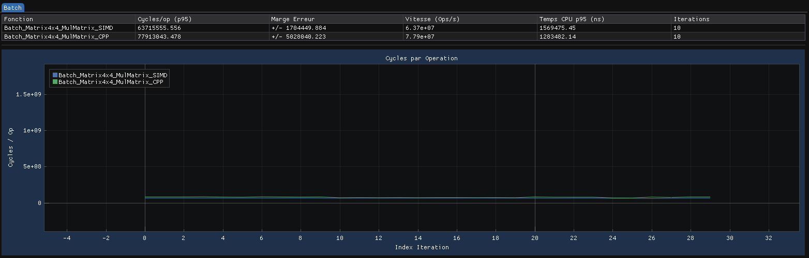

# Optimisation de la bibliothèque mathématique avec SIMD

## 1. Choix de SIMD, SSE et des fonctions intrinsèques

Dans le cadre de l'optimisation de notre bibliothèque mathématique, nous avons choisi d'utiliser les instructions SIMD, principalement à travers la famille SSE. Ce choix est adapté à notre implémentation, qui repose majoritairement sur des calculs en `float`. Les registres de 128 bits permettent de manipuler simultanément quatre valeurs flottantes de 32 bits, ce qui offre une largeur de traitement adaptée à une grande partie de nos opérations vectorielles et matricielles. L'utilisation d'AVX ou d'AVX-512, qui proposent des registres plus larges, n'était pas nécessaire pour cette première implémentation.

L'utilisation de fonctions intrinsèques permet de contrôler directement certaines opérations SIMD et de réaliser plusieurs calculs simultanément, ce qui peut être plus performant qu'une exécution scalaire classique en C++. Cependant, leur utilisation n'est pas systématiquement avantageuse : le compilateur peut déjà optimiser et vectoriser du C++ classique. De plus, certaines instructions supplémentaires, comme les permutations (*shuffle*), peuvent complexifier et alourdir les calculs au point de réduire, voire d'annuler, le gain recherché. Il est donc important de sélectionner les opérations pour lesquelles cette approche apporte un réel intérêt.

## 2. Fonctions optimisées

Les fonctions présentées ci-dessous ont été retenues en raison de leur intérêt pour les calculs vectoriels et matriciels de notre bibliothèque.

### 2.1. Produit scalaire (Dot Product)

Le produit scalaire consiste à multiplier les composantes correspondantes de deux vecteurs, puis à additionner les résultats pour obtenir une valeur unique. SIMD permet d'effectuer les multiplications simultanément sur les différentes composantes du vecteur.

Une fois les multiplications réalisées, il faut cependant additionner les valeurs contenues dans le registre pour obtenir le résultat final. Cette opération de réduction peut notamment être réalisée à l'aide de l'instruction HADD (*Horizontal Add*), qui additionne horizontalement les valeurs d'un registre.

**Intérêt de l'optimisation :** le produit scalaire se prête bien au traitement SIMD grâce aux multiplications indépendantes de ses composantes.

### 2.2. Produit vectoriel (Cross Product)

Le produit vectoriel nécessite plusieurs multiplications et soustractions entre les composantes de deux vecteurs. Ces opérations peuvent être organisées pour être exécutées simultanément à l'aide de SIMD.

Pour réaliser les calculs, certaines composantes doivent être réorganisées dans les registres. Les instructions de permutation (*shuffle*) permettent de modifier leur ordre afin de préparer les multiplications et les soustractions nécessaires.

**Intérêt de l'optimisation :** SIMD permet de paralléliser plusieurs opérations indépendantes, même si les permutations nécessaires ajoutent une certaine complexité au calcul.

### 2.3. Normalisation (Normalize)

La normalisation consiste à obtenir un vecteur de longueur égale à 1 en divisant chacune de ses composantes par sa magnitude. Le calcul de la magnitude nécessite d'abord un produit scalaire du vecteur avec lui-même, suivi d'une racine carrée.

SIMD permet de réaliser simultanément les opérations sur les différentes composantes du vecteur. Il faut toutefois tenir compte de la réduction nécessaire au calcul de la magnitude, ainsi que du cas particulier d'un vecteur nul, qui doit être traité pour éviter une division invalide.

**Intérêt de l'optimisation :** la normalisation combine plusieurs opérations vectorielles qui peuvent bénéficier du traitement parallèle, notamment lors du traitement d'un grand nombre de vecteurs.

### 2.4. Multiplication matrice-vecteur (Matrix-Vector Multiplication)

La multiplication d'une matrice par un vecteur consiste à calculer le produit scalaire entre chaque ligne de la matrice et le vecteur. Chaque composante du résultat correspond donc à une addition de produits entre les valeurs d'une ligne et celles du vecteur.

SIMD permet d'effectuer simultanément les multiplications entre les composantes. Il faut ensuite additionner les résultats de chaque ligne pour obtenir les composantes du vecteur final. Une réduction horizontale peut notamment être utilisée pour cette étape.

**Intérêt de l'optimisation :** cette opération est particulièrement intéressante dans les calculs de transformations géométriques, où les multiplications entre matrices et vecteurs sont fréquentes.

### 2.5. Multiplication matrice-matrice (Matrix-Matrix Multiplication)

La multiplication de deux matrices nécessite plusieurs multiplications et additions entre leurs lignes et leurs colonnes. Chaque composante de la matrice résultat correspond à un ensemble d'opérations similaires à celles d'un produit scalaire.

SIMD permet d'organiser ces calculs afin d'effectuer plusieurs multiplications simultanément. Comme pour la multiplication matrice-vecteur, il faut ensuite regrouper les résultats pour obtenir chaque composante de la matrice finale.

**Intérêt de l'optimisation :** les matrices comportent de nombreuses opérations répétitives qui peuvent être organisées pour tirer parti du traitement SIMD.

### 2.6. Transformation de points (Transform Points)

La transformation d'un point 3D à l'aide d'une matrice 4×4 consiste à appliquer une série de multiplications et d'additions afin de calculer ses nouvelles coordonnées. Dans notre cas, le point est représenté avec une coordonnée homogène égale à 1, ce qui permet notamment d'appliquer les translations.

SIMD permet d'organiser les multiplications et les additions nécessaires à cette transformation. Cette opération devient particulièrement intéressante lorsqu'une même matrice est appliquée à un grand nombre de points.

**Intérêt de l'optimisation :** le traitement par lots (*Batch*) permet de traiter plusieurs points avec une même matrice. C'est un cas d'utilisation particulièrement pertinent pour SIMD, notamment dans les moteurs de jeu et les calculs géométriques.

## 3. Analyse des performances

Les différents benchmarks réalisés montrent que l'utilisation de SIMD peut apporter des améliorations intéressantes par rapport à une implémentation C++ classique. Dans la majorité des opérations testées, notre version SIMD présente des résultats encourageants, avec des gains particulièrement visibles sur certaines opérations vectorielles et matricielles.

En considérant uniquement les mesures de cycles par opération obtenues lors de nos premiers tests, nous observons une réduction moyenne d'environ 27 % sur l'ensemble des fonctions étudiées. Cette valeur reste toutefois indicative et doit être interprétée avec précaution, car certaines mesures présentent des écarts entre les différentes métriques utilisées pour évaluer les performances.

Toutes les opérations ne bénéficient cependant pas de la même manière de cette optimisation. Certaines fonctions, comme le produit vectoriel sur les Vec3, la normalisation des Vec3 ou encore les multiplications matricielles, présentent des résultats favorables à SIMD. D'autres opérations, en revanche, montrent des performances très proches entre les deux implémentations.

Il existe également des cas dans lesquels SIMD se révèle moins intéressant. C'est notamment le cas de la normalisation des Vec4, pour laquelle l'implémentation SIMD nécessite environ **27,84 % de cycles supplémentaires** par rapport à l'implémentation C++ classique. Dans cette situation, conserver l'implémentation C++ peut être plus judicieux. Une autre possibilité serait d'adopter une approche hybride, en utilisant SIMD uniquement pour les opérations où son utilisation apporte un bénéfice réel.

Ces résultats montrent donc qu'il n'est pas pertinent de chercher à utiliser SIMD systématiquement dans l'ensemble de la bibliothèque. Le choix entre une implémentation C++ classique, une version SIMD ou une combinaison des deux doit dépendre de la nature de chaque opération et des performances réellement obtenues.

Enfin, ces premiers benchmarks constituent une base de comparaison qui pourra être affinée à mesure que l'implémentation évolue. Certaines fonctions SIMD peuvent encore être améliorées, notamment en travaillant sur l'organisation des données, la réduction du nombre de permutations et la limitation des opérations intermédiaires.

L'objectif reste donc de développer une bibliothèque cohérente et performante, en privilégiant les solutions qui apportent un gain mesurable plutôt que d'utiliser SIMD de manière systématique.

## 4. Objectifs et démarche personnelle du projet

Même si le cahier des charges ne demande pas de réimplémenter l'intégralité de la bibliothèque mathématique en SIMD, nous avons choisi d'aller plus loin dans cette démarche en développant une version SIMD étendue de notre bibliothèque.

Ce choix répond avant tout à un objectif d'apprentissage. Nous souhaitons comprendre plus en profondeur le fonctionnement des instructions SIMD, l'utilisation des fonctions intrinsèques et les possibilités offertes par SSE. Il ne s'agit pas uniquement de reproduire des opérations mathématiques avec des instructions différentes, mais également de comprendre comment le processeur exécute ces calculs et comment organiser le code pour exploiter efficacement ses capacités.

Un autre objectif important est d'identifier les limites de cette approche. Certaines opérations peuvent être relativement simples à adapter au SIMD, tandis que d'autres nécessitent davantage de permutations, de réorganisations de données ou d'opérations intermédiaires. Cette complexité supplémentaire peut parfois réduire, voire annuler, les gains de performances par rapport à une implémentation C++ classique déjà bien optimisée.

Nous souhaitons donc étudier concrètement les situations dans lesquelles il est préférable de conserver une implémentation C++ classique, d'utiliser des instructions SIMD ou de combiner les deux approches. L'objectif est de comprendre quand chaque solution est réellement pertinente, plutôt que de chercher à utiliser SIMD systématiquement.

Cette démarche repose ainsi sur deux aspects complémentaires : approfondir notre compréhension des optimisations bas niveau et évaluer leurs bénéfices réels à travers des comparaisons et des benchmarks. Le but n'est pas d'utiliser SIMD simplement pour utiliser SIMD, mais de développer une logique d'optimisation cohérente, basée sur la nature des calculs et les résultats obtenus.

## 5. Conclusion

L'utilisation de SIMD et des fonctions intrinsèques SSE permet d'exploiter le parallélisme offert par le processeur pour certaines opérations mathématiques de notre bibliothèque. Les calculs vectoriels et matriciels constituent des candidats intéressants, car ils contiennent souvent plusieurs opérations indépendantes pouvant être exécutées simultanément.

Cependant, l'utilisation de SIMD demande une organisation spécifique des données et des calculs. Certaines opérations nécessitent des permutations ou des réductions supplémentaires, qui peuvent limiter les gains obtenus. C'est pourquoi chaque optimisation doit être évaluée à l'aide de benchmarks afin de vérifier si elle apporte une amélioration réelle par rapport à une implémentation C++ classique.

Au-delà des performances, cette démarche nous permet surtout de mieux comprendre les possibilités et les limites de l'optimisation bas niveau. Elle nous aide à développer une approche plus réfléchie de l'optimisation, en choisissant les outils et les méthodes en fonction des besoins réels plutôt qu'en cherchant à appliquer une technique de manière systématique.